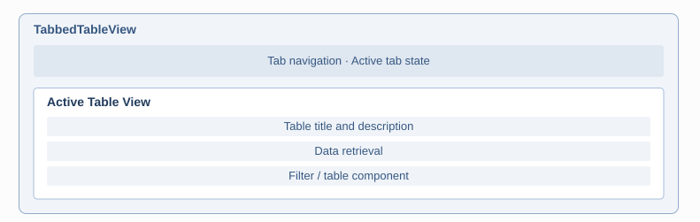

# Table views

`TableView` presents a standalone table with its title, description and loading/error/empty states. `TabbedTableView` composes the shared `Tabs`, `Tab`, `TabHeader` and `TabBody` from `@niagads/ui/client` with `variant="integrated"`, adding table data management and retained table state. Both are exported from `@niagads/table`.

`TabbedTableView` is one application of `TableView`, not a requirement for using it. A `TableView` can appear on its own in a page, dashboard section or another layout. Its configuration and data-source handling are the same whether it is standalone or inside tabs.



The diagram shows the composition, not the request timing: background fetching also retrieves data for inactive tabs by default. The table and filter UI render on first selection.

## Data sources

Use existing `data: rows` for data already available, or `dataSource` for one of three source types. Columns and options use the existing Table types.

```tsx
const publications = {
    id: "publications",
    title: "NIAGADS Publications",
    description: "Publications authored by NIAGADS investigators and collaborators.",
    columns: publicationColumns,
    dataSource: { type: "file", path: "/data/publications.json" },
};

const associations = {
    id: "associations",
    title: "Alzheimer’s Disease Associations",
    columns: associationColumns,
    dataSource: { type: "endpoint", url: "/api/associations" },
};
```

Render the file-backed example directly, without a tab wrapper:

```tsx
import { TableView } from "@niagads/table";

<TableView config={publications} />;
```

`description` belongs to the table-view configuration alongside `dataSource` and appears below the title; the source itself specifies how to retrieve the rows.

File paths are browser-accessible JSON URLs, such as a file served from `public/data`. Arbitrary source-code filesystem paths cannot be loaded by the browser. File and endpoint sources use fetch, check HTTP status and parse JSON. By default the response must be a row array in the existing Table data format. For wrapped responses, supply `select` only when needed:

```tsx
dataSource: {
    type: "endpoint",
    url: "/api/associations",
    select: (response: unknown) => (response as AssociationResponse).records,
}
```

For custom authentication, non-JSON files or other special handling, override the loader:

```tsx
dataSource: {
    type: "custom",
    cacheKey: "publications:authored:user-123",
    load: async (signal: AbortSignal) => {
        const response = await fetch("/api/publications?subset=authored", { signal });
        if (!response.ok) throw new Error("Unable to retrieve publications.");
        return adaptPublications(await response.json());
    },
}
```

Custom cache keys must uniquely identify the requested data, including parameters and user/tenant scope where applicable. Keep optional `select` functions stable (module scope or `useMemo`). Changing a URL, selector or custom cache key selects a different cache entry; older responses cannot replace the new source's data. Changing only the custom loader function does not invalidate its cache key.

## Fetch timing and table rendering

```tsx
const config: TabbedTableConfig = {
    fetchPolicy: "background", // default; omit this for the same behavior
    defaultTab: "authored",
    tabs: [
        { id: "authored", label: "NIAGADS Authored", count: 23, table: authoredTableConfig },
        { id: "enabled", label: "Research Enabled", table: enabledTableConfig },
    ],
};

<TabbedTableView config={config} />;
```

Background mode starts all tab requests when the wrapper mounts. Table/filter UI mounts only when first selected, then remains mounted while hidden to retain search, filters, sorting, pagination and column visibility. Selecting a tab before its request completes displays loading; selecting it after completion displays the cached table immediately. Only an application's explicit `fetchPolicy: "onSelect"` defers fetching until first selection.

A supplied `count` takes precedence. Otherwise headers use the static or fetched array length when available, including zero. That length is the number of loaded records, not a paginated endpoint's total. Supply a known total through `count` when needed. Unknown counts are omitted until data arrives.

SWR manages shared caching and request deduplication. Focus, reconnect and stale-cache revalidation, and automatic error retries, are disabled to avoid unexpected table refreshes. Errors show a manual Retry control. Shared in-flight requests may finish after unmount so other consumers can reuse their results; the component does not abort shared requests when a tab disappears. Empty successful results use the existing informational Alert.

Memory grows with visited tables; interaction state lasts for the mounted wrapper's lifetime. SWR cache lifetime follows the application's SWR provider. Removing a tab or changing its ID discards its table UI. Give table configs distinct `id` values as for standalone tables.

## Navigation and Storybook

`selectedTab` and `onTabChange` support external or URL-backed selection; the caller owns browser history. `defaultTab` is the initial uncontrolled selection. Blank/duplicate tab IDs, empty lists and unknown configured selections throw actionable errors. Keyboard navigation, focus management, unique tab/panel IDs and the responsive dropdown are shared UI Tabs behavior for every variant. Arrow/Home/End keys use automatic activation. At container widths of 40rem or less, a labeled native dropdown replaces the tab strip without replacing the views. An optional `label` supplies a visible dropdown caption and names both controls; without it, shared Tabs supplies the accessible name “Tabs” without a visible caption.

Storybook examples are passive UI examples with no automated interactions:

- **Default:** both simulated two-second requests start immediately, with counts supplied in advance.
- **Load on Select:** explicitly opts into `onSelect` with the same simulated delay.
- **Mobile Responsive View:** shows the dropdown in a narrow container.
- **External Tab Control:** demonstrates application-owned selection.
- **Table from a JSON File**, **Table with No Records**, **Loading Indicator**, and **Request Failure and Manual Retry:** demonstrate standalone presentation states.
